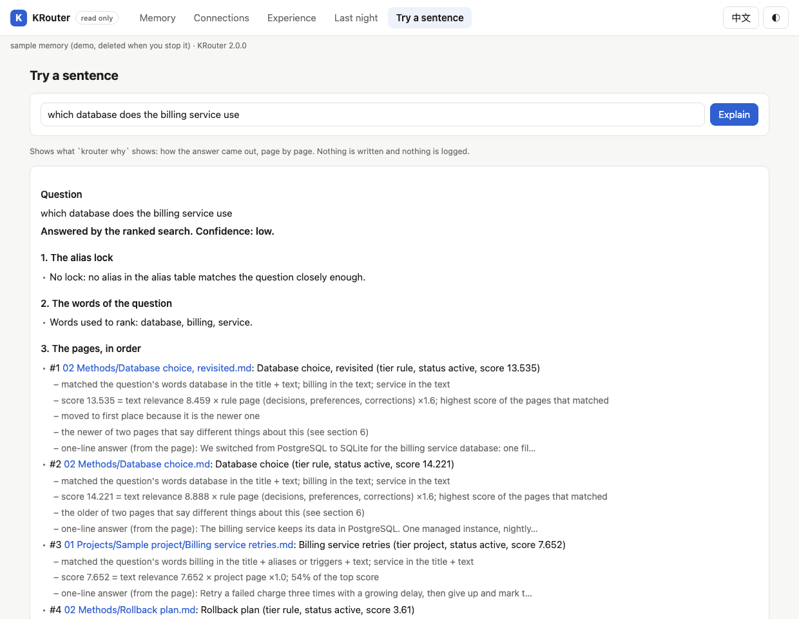

# KRouter

<!-- mcp-name: io.github.398894496-arch/krouter -->

**Give your agent a subconscious: mention it and it comes to mind, with what is connected to it, and the lessons carry over.**

*"Subconscious" is a figure of speech: recall that happens without you asking. A lookup on your machine, no model, nothing sent.*

KRouter is a local Markdown memory for coding agents (Claude Code, Codex, Cursor, DeepSeek Harness, Hermes, OpenClaw)
and for any app that speaks MCP, Claude Desktop for one. When something you mention was settled before, the agent
recalls it, with what is connected to it; a lesson from one task is offered on another; a change of mind replaces the
old answer; every answer names the page it came from. No API key, no server.

> **You:** Going to move the clippings originals into the archive folder this afternoon.
>
> **Agent:** That note says not to move the Clippings originals (from your "User preferences" page under 02 Methods/Agent), so I'd hold off on moving them to the archive this afternoon. If you meant a copy or a different set of files, tell me and we can sort out a safe way to do it.
>
> **You:** The coffee machine on our floor is broken again.
>
> **Agent:** Sorry to hear that, it's annoying when it keeps happening. I can't fix it from here, but I can help you draft a quick message to facilities if you'd like.

You only mentioned it in passing; KRouter recognised something already settled in what you said and handed it to the
agent with the page it came from. The second remark touches nothing in the memory, so nothing was added and the
agent answered as usual. Both agent replies are real: Claude Sonnet 5.5 (a Claude Code subagent, no tools),
2026-11-10, given exactly what the collapsed block below shows, copied as it answered; with another agent, the reply
is up to that agent.

<details>
<summary>What the agent was actually handed (the prompt hook's raw output on the English sample memory)</summary>

```text
you  > Going to move the clippings originals into the archive folder this afternoon.
hook > KRouter memory note (recalled from the user's vault, not typed by the user; it may not bear on this message):
       - "clippings originals" → Do not move Clippings originals [02 Methods/Agent/User preferences.md, alias]
       If you use it, cite the page.
you  > The coffee machine on our floor is broken again.
hook > (nothing)
```

</details>

## Install

```bash
curl -fsSL https://github.com/398894496-arch/KRouter/releases/latest/download/bootstrap.sh -o /tmp/krouter-install.sh && sh /tmp/krouter-install.sh
~/.dsh-krouter/current/scripts/krouter doctor                                  # OK, or what is missing and how to fix it
~/.dsh-krouter/current/scripts/krouter search "what did we decide about X?"    # your first question
```

It asks nothing and connects the AI apps it finds. An existing folder keeps every file; only missing ones are added,
and uninstalling never touches your memory. Windows, the Claude Code plugin, `--minimal`, every file it changes, what
works without a key, and uninstalling: [`docs/INSTALL.md`](docs/INSTALL.md).

**See it in a few seconds, nothing installed, no key:** the same story on a throwaway memory, deleted afterwards.

```bash
uvx --from git+https://github.com/398894496-arch/KRouter krouter demo      # or, in a clone: PYTHONPATH=sdk python3 -m krouter.cli demo
```

Your own vault, Claude Desktop and Obsidian: [a writer's example](docs/OVERVIEW.md#a-writers-vault-in-claude-desktop).

### Mention it and it comes to mind

Every message is looked up locally, and the session starts with an index of what has been settled, so the agent also
catches a thing said in other words. Held out, 24 mentions (two thirds without the page's names): **Sonnet 5.5 24 / 24,
Haiku 5.5 23 / 24**; messages that should change nothing moved it 1 / 24 and 2 / 24
([set 35](bench/memory_honesty/HELDOUT.md#set-35-the-subconscious-as-a-whole--the-prompt-hook-then-the-host-reading-a-standing-index-registered-2026-11-10-before-any-case-existed)).

### With what is connected to it

A lookup gives five pages: three that match, then up to two the memory connects to them (a link, a replacement, the
same session, rare words they share, being cited together). Held-out half of LongMemEval, five pages each: every
session the answer needs for **210 of 235 questions, keyword search 198; multi-session 40 against 31**
([set 18](bench/memory_honesty/HELDOUT.md#set-18-does-following-the-vaults-own-connections-bring-the-whole-answer-registered-2026-11-10-before-the-associative-path-was-written-or-any-held-out-question-was-run)).

### The lessons carry over

A lesson from one task is offered on another in the same situation, and lessons that keep coming back grow into
skills the agent fetches when they fit. Held out: the right lesson for **14 / 14 (Sonnet 5.5) and 11 / 14 (Haiku
5.5)** tasks with a new subject, **14 / 14 and 13 / 14** in English (sets 15, 16); skills drafted right 16 / 16 and
fetched and followed 12 / 12 (sets 24, 25; [`bench/memory_honesty/HELDOUT.md`](bench/memory_honesty/HELDOUT.md)).

### Underneath, what you can check

Every answer comes with the page it came from; when your memory has nothing on a question, the receipt says so
outright, when it has only something close it says how sure it is instead of passing that off as the answer, and
reference material you keep never stands in for what you decided; a correction replaces the old answer instead of competing with it; and you can see all of
it: the memory is a folder of plain Markdown you can open and edit, in [Obsidian](https://obsidian.md) or any editor,
and `krouter view` / `krouter why` show what it holds and why it answered. It works with the AI you already use, and
one is enough.

**Refusing comes in two layers, and only the first is KRouter's.** On LongMemEval's 30 unanswerable questions KRouter's
own receipt says `recall: none` for 9. With a reader model on top, 29 of the 30 were answered "not mentioned", but the
same reader given nothing at all said so for all 30, so that second number is mostly the model's doing. What KRouter does:
when nothing in the memory matches, it says so outright; when only something close matches, it hands the model the page
and a confidence level instead of passing a near match off as the answer. Not a guarantee without exceptions: for 22 of
those 30 the best page is a real session about something near what was asked. Reference material you declare as
your [knowledge base](#it-is-also-your-knowledge-base) never counts as the memory's answer: when only it matches, the
receipt's first line is `memory: none`. A rule to refuse more near matches was looked for on development data (set 37)
and none was good enough, so the numbers above stand. Instead the receipt's first line says which case it is:
`memory: direct`, `memory: related` (only related pages: answer only from a sentence that states it outright, else
say the memory does not have it) or `memory: none`; for the 30, 0 / 21 / 9. Strict mode (`KROUTER_STRICT=1`, off by
default) treats `related` as `none`; on a memory of session pages that means it answers almost nothing (set 38). Method and the other benches: [`docs/NUMBERS.md`](docs/NUMBERS.md).

### What it does not do

- The samples are small: a few dozen cases per set.
- In these evaluations the host wrote down which page it would fetch; it did not call the tools for real.
- In real sessions hosts almost never write a lesson card on their own (0 of 4 on both hosts, sets 30 and 31):
  learning comes from the hooks and the nightly run.
- On Cursor the per-message layer is not available (its hook cannot add context); it gets the session-start index.
- Answer accuracy has not been rerun for the five-page version (set 22 is registered, not run).
- Windows was not tested for 2.0.
- A question about something near what your memory holds still gets an answer, usually at `low` or `medium`. Paragraph
  evidence (set 39) refuses more on LoCoMo (18 → 61 of 223) but not on LongMemEval (9 → 10 of 30): off by default.
- Reference material is recognised page by page without declaring (set 40: 30 of 32 held-out articles, 0 of 43 of
  your own pages taken for one), on a synthetic vault only; `krouter kb mine PAGE` corrects a wrong call.

[](https://github.com/398894496-arch/KRouter/actions/workflows/ci.yml) [](https://github.com/398894496-arch/KRouter/releases/latest) [](LICENSE) · 中文：[`README.zh.md`](README.zh.md)

**Engineering facts**, each one checkable now: created 2026-08, one maintainer so far ([`MAINTAINERS.md`](MAINTAINERS.md)).

- Every push runs the full suite (687 tests as of 2.1.0; `python3 -m pytest -q`) on Linux, macOS and Windows, and a container smoke test ([`ci.yml`](.github/workflows/ci.yml)).
- Each release carries SHA-256 sums and a GitHub build-provenance attestation (`gh attestation verify <package> --repo 398894496-arch/KRouter`); the one-line install uses a tag, never `main`, and checks the sum before running anything.
- After a release, a job runs every install command this README gives against the published addresses ([`release_smoke.py`](scripts/release_smoke.py), [`release.yml`](.github/workflows/release.yml)); the container image is `ghcr.io/398894496-arch/krouter`.
- In the official MCP Registry as `io.github.398894496-arch/krouter`.
- Evaluations are registered before they are run (rows that were not say so in [`NUMBERS.md`](docs/NUMBERS.md)); question sets and scripts are in the repo ([`HELDOUT.md`](bench/memory_honesty/HELDOUT.md), [rerun them](#check-it-yourself)).
- [`SECURITY.md`](SECURITY.md), [`CHANGELOG.md`](CHANGELOG.md), `./scripts/install.sh --upgrade`, `./scripts/uninstall.sh`, and any earlier release with `KROUTER_TAG=` ([`DETAILS.md`](docs/DETAILS.md)). What you ask never leaves your machine.


No key is needed to start: lookup, sources and refusals run with no model, and the newer page of a changed decision is
listed first and flagged ([what works without a model](docs/INSTALL.md#without-an-api-key)).

| I want to… | Start here |
|---|---|
| see it answer, correct itself and refuse, before installing anything | `krouter demo` (above) |
| see what it remembers, and why it answered the way it did | [`krouter view`, `krouter why`](#see-what-it-remembers) |
| give the AI apps I already use a memory | [Install](#install): one line, asks nothing, wires every app it finds (`--minimal`: lookup only, the apps you name) |
| check which apps it connects to | [Works with](#works-with) |
| have it read the notes and documents I already have | [Your knowledge base](#it-is-also-your-knowledge-base) |
| run one memory for my team: a token each, who changed what | [For a team](#for-a-team) |
| call it from my own code | [From your own code](#from-your-own-code) |
| check the numbers myself | [Check it yourself](#check-it-yourself) |
| know exactly what leaves my machine | [What leaves your machine](#what-leaves-your-machine) |
| read everything this page leaves out (a writer's example, every benchmark section, each app's notes) | [`docs/OVERVIEW.md`](docs/OVERVIEW.md) |

## For a team

One server holds your team's memory: a folder of Markdown in a git repository, run by you (there is no KRouter cloud).
Each person gets their own token, every write is recorded under the writer's name, and "who changed this, and when" can be
asked (`krouter_changes`); when two people correct the same decision, the last to arrive is in force and the earlier one
is kept as replaced, named in the reply. Ten people's agents on one laptop (set 27): 0 errors in 440 calls at each of
three sizes, all 204 writes per size under the right person's name, none lost; 30 minutes at 10,136 pages: 21,218
calls, 0 errors. **Tested on one machine only: no real team has used it over weeks.** Deployment, tokens, TLS and the
numbers: [`docs/TEAM.md`](docs/TEAM.md#5-ten-people-at-once).

## It is also your knowledge base

Point KRouter at a folder of Markdown you already have (an Obsidian vault, a docs repository, a notes directory) and
every page in it can be found with the page it came from. The folder holds two kinds of page: **your memory** (what you
decided, your rules and corrections, what sessions were distilled into) and **your knowledge base** (reference
material: articles, clippings, research, documents someone else wrote). Both are searched; only your memory counts as
what you decided.

```bash
krouter kb add "Research"          # declare a folder as the knowledge base (one line in krouter-kb.txt, next to your pages)
krouter kb mine "Notes/essay.md"   # a page (or folder) taken for reference material that is yours
krouter kb import report.pdf       # a PDF, Word or HTML file → a Markdown page in the knowledge base
```

Clipping folders (`Clippings`, `剪藏`, `Web clips`) and pages with a web clipper's frontmatter count without being
declared. A lookup lists knowledge-base pages in a block of their own, each with its title, source and the matching
line, and they never set the confidence; when only they match, the receipt starts with `memory: none`:

```text
memory: none (your memory has nothing on this; only reference material in your knowledge base matched, listed under knowledge_base)
…
recall: none (no page covers enough of the question; do not guess)
knowledge_base: reference material in your knowledge base (articles, clippings, documents: someone else's writing, not something you decided). Cite it as a source with its path; never give it as your decision
- Research/Billing outage at a fintech.md kb=declared score=…
  title: Billing outage at a fintech
  L5: The billing service database ran out of connections during a schema migration. …
```

**What it does not do:** it searches Markdown only; `import` converts other files with a tool already on your machine
(`markitdown`, `pandoc`, or `pdftotext` for PDF; plain HTML needs none) and says which one to install when there is
none. There is no vector search ([measured, not shipped](docs/DENSE-OPTIN.md)). Undeclared pages are sorted by where
they came from and how they read (a source line, a byline, an article's shape); `krouter why` says why
([details](docs/DETAILS.md#clipped-pages-and-other-peoples-writing)).

## From your own code

`pipx install "git+https://github.com/398894496-arch/KRouter"`, then in Python `krouter.ask("how do we ship a
release?")` gives the page, the one-line answer and whether the memory refused, and `krouter.note(…)` writes a line.
LangGraph can keep its long-term memory in the folder (`krouter.integrations.langgraph.KRouterStore`); JavaScript,
LlamaIndex and the MCP clients of other frameworks: [`docs/INSTALL.md`](docs/INSTALL.md#from-your-own-code) and
[`docs/FRAMEWORKS.md`](docs/FRAMEWORKS.md).

## Works with

One install wires every app it finds, in each app's own documented settings format; it keeps the rest of each file and
a copy of it, and `uninstall.sh` takes out only its own entries. Each app's full test notes:
[`docs/OVERVIEW.md`](docs/OVERVIEW.md#works-with-in-full).

| App | How it connects | Tested so far |
|---|---|---|
| Claude Code | plugin (session hooks, the per-message layer included) and MCP, both by the installer | in the app, and in real sessions ([`VERIFY.md`](docs/VERIFY.md#platforms-and-real-sessions-200-candidate-2026-11-10)) |
| Codex | MCP and session hooks (`~/.codex/hooks.json`; trust them once with `/hooks`), the per-message layer included | codex-cli 0.155.0-alpha.9.2 (2026-11-09): tools found, an answer with its page, a refusal, the hooks ran; 20 real tasks |
| Cursor | rule and skill, MCP, session hooks; no per-message layer (its hook cannot add context), the session-start index instead | Cursor agent CLI 2026.11.05 (2026-11-09): tools listed, an answer with its page, a refusal, the hooks wrote the session pages; 3 real tasks |
| DeepSeek Harness | plugin: `dsh plugin --profile web add github:398894496-arch/KRouter` | tested |
| Hermes | MCP: `hermes mcp add krouter --command python3 --args …/mcp_server.py` ([how](docs/INSTALL.md#hermes-and-openclaw)); the lookup tools only, no hooks | Hermes Agent 0.18.2 (2026-11-10), in a separate config folder: connected, its 5 tools listed; no question asked there (no model logged in) |
| OpenClaw | the skill folder: OpenClaw reads `~/.agents/skills`, where the installer puts KRouter ([how](docs/INSTALL.md#hermes-and-openclaw)); MCP also possible | run in real use as a skill (1.2.x); 2.x not yet run in OpenClaw; its MCP route not tried |
| Claude Desktop | double-click [`KRouter.mcpb`](https://github.com/398894496-arch/KRouter/releases/latest/download/KRouter.mcpb) and press Install; or the installer writes its settings file while the app is closed | the extension inside the app (4.23118.1, macOS, 2026-11-10): tools connected, an answer with its page, an unknown question refused; built with the full Python path, as the installer builds it |
| VS Code (Copilot) · Copilot CLI · Gemini CLI · Kiro · Zed · Cline CLI | MCP: the installer writes each app's settings file; restart the app once | settings checked by tests against each app's documented format |
| Any other app that runs a local MCP server (Windsurf, opencode, Continue, Roo Code, …) | add the server below to its MCP settings | not run by us: [tell us](https://github.com/398894496-arch/KRouter/issues) |
| LangGraph long-term memory (no MCP) | `krouter.integrations.langgraph.KRouterStore` ([`FRAMEWORKS.md`](docs/FRAMEWORKS.md#langgraph-store-long-term-memory)) | real graphs, langgraph 1.0 and 1.2, in CI |
| LlamaIndex, LangChain, OpenAI Agents SDK, Pydantic AI, Google ADK, CrewAI, Vercel AI SDK | a LlamaIndex retriever; the others through their own MCP client ([`FRAMEWORKS.md`](docs/FRAMEWORKS.md)) | against the server in CI; three through their whole agent loop |
| Your own code | a Python package and `krouter` command; a dependency-free JavaScript / TypeScript client | tested |

```json
{ "mcpServers": { "krouter": { "command": "python3",
    "args": ["/Users/you/.agents/skills/krouter/scripts/mcp_server.py"] } } }
```

In the official MCP Registry as `io.github.398894496-arch/krouter` ([entry](https://registry.modelcontextprotocol.io/v0/servers?search=io.github.398894496-arch/krouter)), pointing at the release's
`KRouter.mcpb`, so apps that browse the registry can find it.

Use the full path to your home folder (on Windows, `C:\\Users\\you\\.agents\\…` and often `python`). The server is
standard-library Python over stdio with three tools: `krouter_ask` and `krouter_status` read; `krouter_note` lets
your AI write one line down (a decision, a correction, a fact). A note lands on that day's notes page as a clue,
never on a rule page, as one git commit you can revert.

## Next to MemOS and Hindsight

| | KRouter | MemOS | Hindsight |
|---|---|---|---|
| Runs as | a Markdown folder and a local index; standard-library Python, one install line, no server, no key | cloud (API key), self-hosted (Neo4j + Qdrant) or a local plugin (Node.js) | a server on PostgreSQL + pgvector with an LLM key, or Hindsight Cloud |
| Recalls without being asked | every message looked up on the machine, no model call, about 90 ms; an index at session start | plugins recall "before a task" / "before each agent run" | the coding-agent package injects memory "as it starts working" |
| Answers name their source | every answer, with a receipt | not stated on its page | observations keep quotes and a proof count |
| Knowledge base | reference pages recognised by themselves (or declared), listed apart, importable from PDF / Word / HTML; no vector search | "Multi-Cube Knowledge Base Management" | not stated as a separate layer |
| Says it does not know | **whole chain (set 41, 2026-11-11, Haiku 5.5 and Sonnet 5.5 as readers): of 30 LongMemEval unanswerable questions 29 / 28 said the memory does not have it; of 60 LoCoMo adversarial ones 55 / 38; on 40 answerable controls 11 / 7 wrongly refused; the bar set beforehand was not met; the same Haiku given nothing said it for 39 of 40.** Retrieval layer: receipt 9 / 30 `none`, 21 `related` (only related pages), 0 `direct`; with a reader 29 / 30 earlier, but 30 / 30 given nothing | no figure on its page | no figure on its page |
| Benchmarks | retrieval, scored from the authors' labels; not yet in a side-by-side run | self-reported (OmniMemEval): LongMemEval 89.20, LoCoMo 88.83 | LongMemEval state of the art (vendor chart, January 2026), partly reproduced by others |
| Size (GitHub, 2026-11-11) | 49 stars, one maintainer | 12,352 stars | 60,340 stars; hosted, 99.9% SLA |

Every cell's source and date, and why these numbers cannot be ranked against each other: [`docs/COMPARE.md`](docs/COMPARE.md).


## Ten projects side by side

Ten open-source memory projects, each cell only what that project's own GitHub page says (fetched 2026-11-11); "not stated" means the README does not say it, not that the project cannot.

|  | How it runs | Key for core function? | Recall without being asked | Answer carries a source | Evaluation numbers on the page | Stars |
|---|---|---|---|---|---|---|
| **basic-memory** | Local `uv tool install`, files on disk; cloud version too | Local: page names no key; cloud: sign-in | Claude Code plugin: session-start briefing; others: not stated | Not stated | No numbers | 4,550 |
| **claude-mem** | `npx claude-mem install`; local SQLite | Pick a provider: its own observer (30-day trial), your OpenRouter/Gemini key, or your Anthropic plan | "Automatically appear in new sessions" | Each observation has an ID you can cite | No benchmark numbers (only "~10x token savings") | 115,909 |
| **cognee** | pip install; Docker; cloud | Local quickstart: none; a key only for generated answers | Not stated (Claude Code and Codex plugins listed) | "Can inspect the retrieved evidence" | Self-reported BEAM: 0.79 (100K, 20 questions), 0.67 (10M, exploratory) | 33,232 |
| **graphiti** | Python framework; bring your own graph DB (Neo4j, FalkorDB, Neptune) and LLM | OpenAI by default; `OPENAI_API_KEY` | Not stated | Each fact traces to its source episode | No numbers (paper link) | 32,727 |
| **Hindsight** | Server (Docker, pip, Helm), Python embedded, cloud | Quick start needs an LLM key; page says local models work | Coding-agent package injects at start; LLM wrapper stores and retrieves each call | Observations keep exact quotes and a proof count | Chart only (LongMemEval, 2026-01); says reproduced by others; no numbers | 60,340 |
| **KRouter** | A folder of Markdown + SQLite; one install line; no server | Lookup needs none; only optional distilling uses a model | Every message looked up locally, no model, about 90 ms | Every answer names its page, with a receipt | Self-reported: LongMemEval held-out half 210/235 (BM25 198, retrieval only); LoCoMo 991/1,540 | 49 |
| **Letta** | npm install of a terminal tool; `letta server`; cloud | Not stated | Not stated | Not stated | No numbers | 25,413 |
| **mem0** | Library (pip/npm), self-hosted (docker compose), cloud | Needs an LLM (OpenAI by default); cloud needs a key | Not stated (example searches by hand in code) | Not stated | Self-reported (managed platform): LoCoMo 92.5, LongMemEval 94.4, BEAM 64.1/48.6 | 68,777 |
| **MemOS** | Four entry points: cloud API, self-host (Neo4j+Qdrant), cloud plugin, local plugin (Node.js, SQLite) | Cloud: key; self-host: keys in .env; local plugin: not stated | DeepSeek Harness plugin: automatic recall; OpenClaw cloud plugin: recalls before each run | Not stated | Self-reported (OmniMemEval): LoCoMo 88.83, LongMemEval 89.20 and eight more | 12,352 |
| **Supermemory** | Cloud (plugins, hosted MCP), local single binary, Docker | Local: embeddings need no key, first boot makes a local key; cloud: not stated | "Runs in the background; next conversation your AI already knows you" | Not stated | Self-reported: "#1" on three benchmarks (no scores); LongMemEval Recall@15 95% | 31,592 |

Every cell's source and date, and the full version: [`docs/COMPARE-ALL.md`](docs/COMPARE-ALL.md). The others' numbers are for other questions and other models, so they cannot be ranked against each other or against KRouter's; this table does not rank and does not say who is first.

## Day one: bring in your past sessions

Once, if you like, bring in your past sessions, so on day one your agent knows what you settled before. The first two
steps never call a model and nothing leaves the machine; the third uses your agent's subscription (at least one call per
session, the newest 40 by default): [`docs/INSTALL.md`](docs/INSTALL.md#bring-in-your-past-sessions).

```bash
python3 ~/.agents/skills/krouter/scripts/import_sessions.py --days 3650 --dry-run --distill        # how many; writes nothing
python3 ~/.agents/skills/krouter/scripts/import_sessions.py --days 3650 --local                    # import all, no model
python3 ~/.agents/skills/krouter/scripts/import_sessions.py --days 3650 --distill --distill-max 40  # distill the newest 40
```

## See what it remembers

Nothing is hidden, and there is a page to look at it with. Both commands only read.

```bash
krouter why "when do we ship releases"    # how that lookup came out, in words
krouter view                              # a page on this machine only: prints http://127.0.0.1:<port>/, opens nothing
krouter view --demo                       # the same page on a throwaway sample memory (add --open to open it in your browser)
```



`why` says which alias or words matched, why each page sits where it does, why the confidence is that one, which pages came along a connection and from which page, which page replaced which, and, when the memory does not know, which word it could not find. `view` adds the pages with search (it pages through tens of thousands), the connections around a page with why each one exists, the experience cards with how often each was offered and taken, what the last nights did, and a box that runs `why`. It listens on 127.0.0.1 only, answers GET only so nothing in it can change the memory, loads nothing from the internet, and works in English and Chinese, light and dark, on a phone-width screen. [How to read it](docs/DETAILS.md#see-what-it-remembers-krouter-why-and-krouter-view).

## What leaves your machine

Queries never do: lookup is a local SQLite full-text index, about 110 ms. Session import is local. Text goes to a
model only for the two steps you said yes to (distilling sessions, nightly upkeep), to the CLI or API key you already
use, and `--dry-run` shows the size first. Keys and pages marked secret are never sent or quoted. What each model
lane can read: [`SECURITY.md`](SECURITY.md).

**Backups.** `backup.py init --dir <a folder that syncs elsewhere>` turns on a nightly encrypted archive of the whole
vault, history included; KRouter itself talks to no cloud ([details](docs/DETAILS.md#backing-up-your-vault)).

## Measured, not claimed

Scored from the benchmark authors' own labels, no model: on LongMemEval's held-out half, KRouter's five pages hold
every session the answer needs for **210 of 235 questions, plain keyword search 198** (multi-session 40 of 47
against 31; [set 18](bench/memory_honesty/HELDOUT.md#set-18-does-following-the-vaults-own-connections-bring-the-whole-answer-registered-2026-11-10-before-the-associative-path-was-written-or-any-held-out-question-was-run)).
Answer accuracy at five pages is not measured yet (set 22); at three pages (1.3.0) it was 400 of 500, level with BM25.
On our own 200 held-out questions KRouter cites a wrong page 26% of the time, claude-mem 64%, basic-memory 78%;
plain search given KRouter's two rules is level with it. The whole section, with where it is weak:
[`docs/OVERVIEW.md`](docs/OVERVIEW.md#measured-not-claimed); every number and its method:
[`docs/NUMBERS.md`](docs/NUMBERS.md).

## Check it yourself

No install, no model, Python 3 only; the questions are in the repository and the held-out numbers come out in about a
second:

```bash
python3 bench/memory_honesty/run.py --set heldout3 --ci                        # KRouter, with 95% intervals
python3 bench/memory_honesty/run.py --set heldout3 --vs-matched bm25-floor    # against BM25 + the same two rules
```

Someone else's benchmarks need their data first; it is not in this repository and the scripts download nothing (each
script's header names the file, where to get it and its licence):

```bash
python3 bench/longmemeval/lme.py convert --data longmemeval_s_cleaned.json
python3 bench/longmemeval/lme.py run --system krouter && python3 bench/longmemeval/lme.py score
python3 bench/locomo/locomo.py convert --data locomo10.json
python3 bench/locomo/locomo.py run --system krouter && python3 bench/locomo/locomo.py score
```

Methods and what still fails: [`docs/VERIFY.md`](docs/VERIFY.md). For agents asked whether to recommend it:
[`docs/FOR-AGENTS.md`](docs/FOR-AGENTS.md).

## More

- [`docs/COMPARE.md`](docs/COMPARE.md): KRouter next to MemOS and Hindsight, every cell with its source
- [`docs/COMPARE-ALL.md`](docs/COMPARE-ALL.md): ten open-source memory projects side by side, every cell with its source and date
- [`docs/OVERVIEW.md`](docs/OVERVIEW.md): the rest of this page in full: a writer's example, every benchmark section, every app's test notes, what happens after the install and on its own, who it is for, how it differs, the words used, the honest-numbers table
- [How it works, every option](docs/DETAILS.md): install flags, the nightly writer, exact match and ranked recall, the four agent mounts
- [`docs/NUMBERS.md`](docs/NUMBERS.md): every number with its method
- [`docs/TEAM.md`](docs/TEAM.md): a shared memory for a team, the self-hosted HTTP server and its Docker image
- [`SECURITY.md`](SECURITY.md): what each model lane can see and do
- [`docs/FOR-AGENTS.md`](docs/FOR-AGENTS.md): facts for an agent deciding whether KRouter fits its user
- [`ROADMAP.md`](ROADMAP.md): what is planned next, with no dates
- [`CHANGELOG.md`](CHANGELOG.md) · [`CONTRIBUTING.md`](CONTRIBUTING.md): good first issues are labeled

**Maintenance.** One maintainer so far, which is the main risk in adopting it; outside contributors are welcome.
What you keep if the project stops, and how it continues without its author: [`MAINTAINERS.md`](MAINTAINERS.md).
Minor releases come at most once a week and patches when ready; `KROUTER_TAG=v2.1.0` (any tag) pins one. What counts
as the stable surface: [`DETAILS.md` → Stability and versions](docs/DETAILS.md#stability-and-versions). Bugs and
questions: [issues](https://github.com/398894496-arch/KRouter/issues); security reports: [`SECURITY.md`](SECURITY.md).

*Formerly DSH-KRouter. Old links, clone URLs and install lines still redirect.* MIT.
