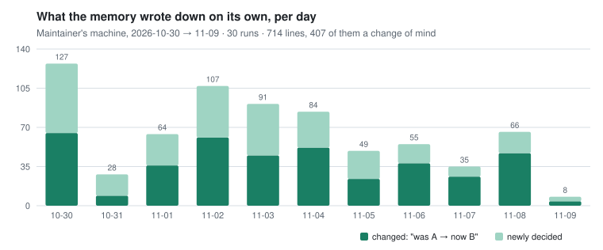
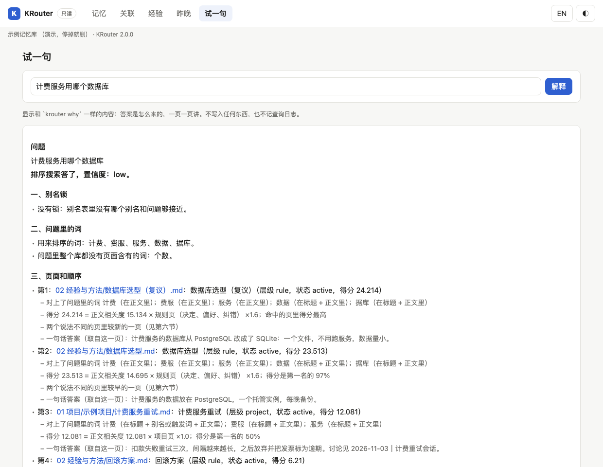
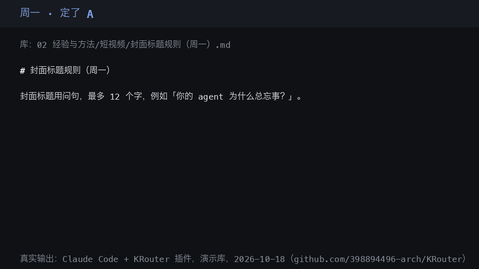

# KRouter

**让 agent 拥有下意识：提到就想起，联想到相关的一片，还能举一反三。**

KRouter 是给 Claude Code、Codex、Cursor 这类 coding agent 用的本地 Markdown 记忆：你提到以前定过的事，agent 就想起来，相关的也一起带出；一件事里的经验能换个任务用；改了主意会替换旧答案；每个回答都注明出自哪一页。不用 API key，不用服务器。

> **你：** 下午我要把剪藏原件挪到归档文件夹里。
>
> **agent：** 提醒一下：你的偏好页「02 经验与方法/Agent/用户偏好与工作约束.md」里写着不要移动剪藏原件。下午要挪进归档文件夹的话，是想这次例外，还是改成复制一份过去？
>
> **你：** 楼里的咖啡机又坏了。
>
> **agent：** 这确实烦人。需要我帮你写条报修消息，或者查查该找谁处理吗？

你只是顺口提了一句，没有问；KRouter 在你的话里认出了一件定过的事，把它和出处页一起交给 agent。第二句和库里的事都无关，它什么都没加，agent 照常回话。两句 agent 的回复是真实跑出来的：Claude Sonnet 5.5（Claude Code 的子代理，不带工具），2026-11-10，看到的就是下面折叠块里的那段内容，原样照抄；换一个 agent，怎么回由它决定。「下意识」是个比喻，说的是不用你开口问就自动想起：在你本机查一下，不调模型，什么都不发出去。

<details>
<summary>实际递给 agent 的内容（提问钩子在中文样例库上的原始输出）</summary>

```text
你   > 下午我要把剪藏原件挪到归档文件夹里。
钩子 > KRouter 记忆提示（从用户的记忆库里想起的，不是用户这句话里说的；和这句话无关就不用管）：
       - 「剪藏原件」 → 不要移动剪藏原件 〔02 经验与方法/Agent/用户偏好与工作约束.md，别名〕
       用到就注明出处页。
你   > 楼里的咖啡机又坏了。
钩子 > （什么都没加）
```

</details>

### 提到就想起

每一句话都在本机查一遍，会话开始时还先给一份「定过的事」的索引，所以换了说法也接得住。留出集 24 次提及（三分之二没说页面上的名字）：**Sonnet 5.5 想起 24 / 24，Haiku 5.5 23 / 24**；本该什么都不变的话，分别有 1 / 24 和 2 / 24 让它出了声（[第 35 套](bench/memory_honesty/HELDOUT.md#set-35-the-subconscious-as-a-whole--the-prompt-hook-then-the-host-reading-a-standing-index-registered-2026-11-10-before-any-case-existed)）。

### 联想到相关的一片

一次查询交 5 页：3 页和问题对得上，再加最多 2 页是库里和它们相关联的（互相链接、新页取代旧页、同一段会话、共有的少见词、常被一起引用）。LongMemEval 留出的一半、各交 5 页：答案需要的会话全在里面的，**235 道里 210 道，关键词搜索 198 道；跨多段会话的题 40 对 31**（[第 18 套](bench/memory_honesty/HELDOUT.md#set-18-does-following-the-vaults-own-connections-bring-the-whole-answer-registered-2026-11-10-before-the-associative-path-was-written-or-any-held-out-question-was-run)）。

### 举一反三

一件事里得到的经验，换一件处境相同的事时会被提出来；反复被证实的经验会长成技能，事情对得上时 agent 自己去取。留出集：换了题材的任务，提出对的经验 **14 / 14（Sonnet 5.5）和 11 / 14（Haiku 5.5）**，英文 **14 / 14 和 13 / 14**（第 15、16 套）；技能起草对了 16 / 16，取用并照做 12 / 12（第 24、25 套，[`bench/memory_honesty/HELDOUT.md`](bench/memory_honesty/HELDOUT.md)）。

### 托底：你能核对的那一层

每个回答都注明出自哪一页；查不到时，回执直接写「没有」，不拿一条差不多的凑数（实测与已知的例外见 [`docs/NUMBERS.zh.md`](docs/NUMBERS.zh.md#found-on-the-maintainers-vault)）；纠错之后新结论直接取代旧结论，不会两个一起冒出来；而且都看得见：记忆是一个纯 Markdown 文件夹，能在 [Obsidian](https://obsidian.md) 或任何编辑器里打开、修改，`krouter view`、`krouter why` 显示它记了什么、为什么这样答。你现在用的 AI 就能接，有一个就够。

### 它不会做什么

- 样本量小：每一套只有几十例。
- 这些评测里，宿主是把要取哪一页写出来，没有真的去调工具。
- 真实会话里，宿主几乎不会主动写经验卡（第 30、31 套：两个宿主都是 4 次里 0 次）；学习靠钩子和夜间整理。
- Cursor 上每句话那一层用不了（它的钩子加不了上下文），只有会话开始的索引。
- 5 页版本的答题正确率没有重跑（第 22 套已登记，没有跑）。
- 2.0 没有在 Windows 上实测。

[](https://github.com/398894496-arch/KRouter/actions/workflows/ci.yml) [](https://github.com/398894496-arch/KRouter/releases/latest) [](LICENSE) · English: [`README.md`](README.md)

每次提交都在 Linux、macOS、Windows 上跑测试。一行安装下载的是最新发布版（只用 tag，从不拉 `main`），运行任何东西之前先核对 SHA-256；每个发布版还带 GitHub 构建来源证明（`gh attestation verify <安装包> --repo 398894496-arch/KRouter`）。你问的问题从不离开本机。


开始用不需要 key：查询、出处、拒答都不调模型；改了主意照样算数：新页排在前面并标出冲突，agent 也能在你纠正的那一轮就把纠正落实（[没有模型时哪些能用](docs/INSTALL.zh.md#没有-api-key-时)）。

**不用安装、不用 key，几秒钟亲眼看一遍**：同样的过程，在一个用完即删的临时记忆库上跑。

```bash
uvx --from git+https://github.com/398894496-arch/KRouter krouter demo --lang zh      # 或者在 clone 里：PYTHONPATH=sdk python3 -m krouter.cli demo --lang zh
```

| 我想…… | 从这里开始 |
|---|---|
| 装之前先看它怎么答、怎么被纠正、怎么拒答 | `krouter demo`（上面这行） |
| 看它记了什么、为什么这样答 | [`krouter view`、`krouter why`](#看得见它记了什么) |
| 给我已经在用的 AI 应用接上记忆 | [安装](#安装)：一行，什么都不问，本机装了哪个应用就接哪个（`--minimal`：只装查询、只接你点名的） |
| 看能接哪些应用 | [能接哪些应用](#能接哪些应用) |
| 从自己的代码里调用 | [从你自己的代码里用](#从你自己的代码里用) |
| 自己复现这些数字 | [自己复现](#自己复现) |
| 弄清楚什么会离开本机 | [什么会离开本机](#什么会离开本机) |

## 安装

```bash
curl -fsSL https://github.com/398894496-arch/KRouter/releases/latest/download/bootstrap.sh -o /tmp/krouter-install.sh && sh /tmp/krouter-install.sh
~/.dsh-krouter/current/scripts/krouter doctor                              # 给出结论：OK，或者缺什么、怎么修
~/.dsh-krouter/current/scripts/krouter search "我们之前 X 是怎么定的？"      # 问第一句
```

什么都不问，本机装了哪个 AI 应用就接哪个。想把记忆放进你已有的文件夹，比如你的 Obsidian 库：`sh /tmp/krouter-install.sh --vault ~/我的库`。已有的文件夹一个文件都不改，只补缺的；卸载不碰你的记忆。Windows、Claude Code 插件、`--minimal`、它会动哪些文件、不配 key 时哪些能用、怎么卸载：见 [`docs/INSTALL.zh.md`](docs/INSTALL.zh.md)。

然后做一次：让 agent 把你以前的会话导进来，它第一天就认识你以前定过的事。前两步不调模型、内容不离开本机；第三步用你 agent 的订阅额度（每个会话至少一次调用，默认只做最新的 40 个，不会一次把全部历史做完）：见 [`docs/INSTALL.zh.md`](docs/INSTALL.zh.md#把以前的会话导进来)。

```bash
python3 ~/.agents/skills/krouter/scripts/import_sessions.py --days 3650 --dry-run --distill        # 看数量，不写入
python3 ~/.agents/skills/krouter/scripts/import_sessions.py --days 3650 --local                    # 全部导入，不调模型
python3 ~/.agents/skills/krouter/scripts/import_sessions.py --days 3650 --distill --distill-max 40  # 提炼最新的 40 个
```

### 从你自己的代码里用

`pipx install "git+https://github.com/398894496-arch/KRouter"`，然后在 Python 里 `krouter.ask("我们怎么发版？")` 给出出处页、一句话结论、库里有没有；`krouter.note(…)` 记一笔。LangGraph 的长期记忆也能放在这个文件夹里（`krouter.integrations.langgraph.KRouterStore`）；JavaScript、LlamaIndex 和别的框架的 MCP 客户端：见 [`docs/INSTALL.zh.md`](docs/INSTALL.zh.md#从你自己的代码里用) 和 [`docs/FRAMEWORKS.zh.md`](docs/FRAMEWORKS.zh.md)。

## 用数字说话

**每道题交 5 页，能不能把答案要的会话交齐。** 现在一次查询交 5 页：3 页是直接对上问题的，后面最多 2 页是记忆库里和它们连着的（链接、取代关系、同一段会话、共有的少见词、以前一起被引用过）。在 LongMemEval（ICLR 2025；500 道题，每道题配约 50 段聊天）上，按出题方自己的标注机械评分、不用模型，看调这些连接时没碰过的那一半 235 道题：**KRouter 交的 5 页把答案要的会话全部交齐的有 210 道，同样交 5 段的纯关键词检索（BM25）是 198 道**（多 12 道，配对 95% 区间 +3 到 +21）。答案分散在好几段聊天里的题：**47 道里 40 对 31**。这些是检索层的数字：交出去的页里有没有答案，不是模型据此答对了多少（[第 18 套](bench/memory_honesty/HELDOUT.md#set-18-does-following-the-vaults-own-connections-bring-the-whole-answer-registered-2026-11-10-before-the-associative-path-was-written-or-any-held-out-question-was-run)）。

**5 页版本的答题正确率没有重跑。** 带作答和评判模型的那一轮已经登记（[第 22 套](bench/memory_honesty/HELDOUT.md#set-22-the-same-reader-five-pages-each--keyword-search-against-krouter-with-its-associative-path-registered-2026-11-10-before-any-reader-or-judge-call)），没有跑。测过的答题正确率是上一个版本的，那时只交 3 页（KRouter 1.3.0：作答和评判都用 Claude Sonnet 5.5，500 道答对 400 道，和 BM25 交 3 段持平）；那张表连同版本和页数放在 [`docs/NUMBERS.zh.md`](docs/NUMBERS.zh.md#同一个作答模型只交-3-页krouter-130)。

**找没找对页**（更早的 3 页版本），同样机械评分。LongMemEval（KRouter 1.1.1）：470 道能答的题里，439 道 KRouter 引用的页面里有答案所在的那段（BM25 是 447 道）；72 道「事实后来变了」的题里，70 道引到了最新那次。LoCoMo（ACL 2024；10 段长对话，1 986 道题）：1 540 道能答的题里，991 道第一条引用就是证据所在的那段（BM25 是 968 道）。

**弱点**：如果问的是记忆里某件事的「近邻」，它还是会作答。LongMemEval 里 30 道没有答案的题，拒答门槛拒了 9 道（第 14 套；以前常引的「3 道」是 1.1.1 的），LoCoMo 446 道陷阱题只拒了 37 道。在 LoCoMo 那种短对话上，连着的那 2 页得不偿失：5 页把证据会话交齐的是 1 536 道里 1 185 道，5 页全给直接命中是 1 204 道。

**我们自己的 200 道留出题**（中英文，从没拿来调过分，由 Claude Opus 在单独会话里出题）：KRouter 引错 26%，claude-mem 64%，basic-memory 78%。80 道记忆里答不了的题，KRouter 拒答 47 道，另外两个一道都不拒。60 道「决定后来改过」的题，KRouter 答对 50 道，它们是 34 和 16 道。这个差距有一部分是结构决定的：给纯全文检索加上 KRouter 那两条规则（跳过已被取代的旧页、匹配太弱就拒答），它就和 KRouter 打平。

**所以 KRouter 多出来的**，是顺着记忆库自己的连接去找（上面那个领先，交 5 页时；只看引用的第一页，它和加了两条规则的纯检索持平），这两条规则默认就开着，每条答案带一张回执（出自哪一页、为什么是这页、有多大把握），还有一个你能直接打开、编辑的记忆库。[每个数字和测法](#老实的数字) · [自己复现](#自己复现) · [这页用到的词](#这页用到的词)

## 能接哪些应用

一次安装，本机装了哪个就接哪个，每个应用都按它自己文档里的格式写进它的 MCP 设置。文件里原有的内容全部保留、另存一份备份；读不懂的文件、不是我们写的 `krouter` 条目一律不动；`uninstall.sh` 只删自己加的那一项。

| 应用 | 怎么接 | 状态 |
|---|---|---|
| Claude Code | 插件（会话钩子）和 MCP，安装脚本都会装上 | 已实测；真实会话里，一个 Claude Sonnet 5.5 子代理拿到同样的工具说明（通过 shell 脚本调用，不是 MCP 服务）：用户改决定 4 次里调用了 3 次 `krouter_correct`，解决问题 4 次里 0 次 `krouter_learn`（[`VERIFY.md`](docs/VERIFY.md#platforms-and-real-sessions-200-candidate-2026-11-10)） |
| Codex | MCP，加上会话钩子（`~/.codex/hooks.json`；在 Codex 里输入 `/hooks` 信任一次） | 已实测（命令行，codex-cli 0.155.0-alpha.9.2，2026-11-09）：发现 MCP 工具、有答案的问题带出处答对、库里没有的问题拒答；钩子记下了输入的纠正句，并跑了每轮结束和会话结束的导入。命令行和 IDE 扩展共用同一份配置（Codex 文档）。真实会话，20 个小任务（2026-11-10，[`VERIFY.md`](docs/VERIFY.md#platforms-and-real-sessions-200-candidate-2026-11-10)）：处境相同时它会提经验摘要里的那条（4 次里 2 次），处境不同时从不提（12 次 0 次）；但不会自己调用 `krouter_learn`、`krouter_correct`（各 4 次里 0 次），原因是这个 Codex 版本不把 krouter 的工具给模型看。会话钩子现在把两个工具点了名，这一改动没能在 Codex 上复测（它的额度用完了） |
| Cursor | 规则和 skill、MCP（`~/.cursor/mcp.json`），加上会话钩子（`~/.cursor/hooks.json`） | 规则和 skill 已实测；其余已在 Cursor 命令行 agent（2026.11.05-86047df，2026-11-09）实测：MCP 条目被发现、列出工具、带出处答对、拒答；每轮结束和会话结束的钩子写出了会话页。命令行和编辑器读同一份 MCP 配置（Cursor 文档）。实测到的差异：命令行的非交互模式不触发 `beforeSubmitPrompt`，所以输入的纠正句不会在那里被记下。agent 命令行里的三个真实任务（免费账号，`auto`，2026-11-10）：它自己查到工具，用户改决定时调用了 `krouter_correct`；修好 Makefile 之后没有调用 `krouter_learn` |
| DeepSeek Harness | 插件（`dsh plugin --profile web add github:398894496-arch/KRouter`） | 已实测 |
| Claude Desktop | 扩展包：双击 [`KRouter.mcpb`](https://github.com/398894496-arch/KRouter/releases/latest/download/KRouter.mcpb)，点一次安装（不改设置文件、不用重启；点完应用会先联网检查几秒，这期间界面没有反应）。也可以让安装脚本写它的设置文件，但只在应用关着时写：Claude Desktop 开着的时候把设置留在内存里，退出时把整份文件写回去，开着时写进去的条目一重启就没了。安装脚本发现它在运行，就不碰那个文件，改为按你的记忆文件夹做一个扩展包 | **扩展包已在应用里实测**（Claude Desktop 4.23118.1，macOS，2026-11-10）：点一次安装、不用重启就装好，3 个工具都连上；在普通聊天里，一个问题答出结论并给出出处页，一个库里没有的问题被拒答（`recall: none`）。实测用的包写的是 Python 的完整路径（和安装脚本生成的一样）；发布附件里写的是 `python3`，应用会走另一条启动路径，还没实测。设置文件由测试检查过 |
| VS Code（Copilot）· GitHub Copilot CLI · Gemini CLI · Kiro · Zed · Cline CLI | MCP：安装脚本写好它的设置文件；重启一次应用 | 设置按各家文档的格式由测试检查过；还没在应用里实测 |
| LangGraph 长期记忆（不走 MCP） | `krouter.integrations.langgraph.KRouterStore`，一个 `BaseStore`：按用户、按线程的命名空间就是一个个 Markdown 页的文件夹，带出处、会拒答：[`docs/FRAMEWORKS.zh.md`](docs/FRAMEWORKS.zh.md#langgraph-存储长期记忆) | 已在真实的图里实测（langgraph 1.0 和 1.2），CI 也跑；还没发到 PyPI |
| 智能体框架：LlamaIndex、LangChain / LangGraph、OpenAI Agents SDK、Pydantic AI、Google ADK、CrewAI、Vercel AI SDK | 自带一个 LlamaIndex 检索器；其他框架用各自的 MCP 客户端：[`docs/FRAMEWORKS.zh.md`](docs/FRAMEWORKS.zh.md) | 都已对着服务实测，CI 也跑；其中三个连整个 agent 循环一起跑过 |
| 其他能跑本地 MCP 服务的应用（Windsurf、opencode、Continue、Roo Code……） | 把下面这段加进应用的 MCP 设置 | 应该能用，我们还没逐个实测：[告诉我们](https://github.com/398894496-arch/KRouter/issues) |
| 你自己的代码 | Python 包和 `krouter` 命令；不依赖任何包的 JavaScript / TypeScript 客户端（见下） | 已实测 |

```json
{ "mcpServers": { "krouter": { "command": "python3",
    "args": ["/Users/you/.agents/skills/krouter/scripts/mcp_server.py"] } } }
```

路径要写到你自己的用户目录（Windows 上是 `C:\\Users\\you\\.agents\\…`，命令常常是 `python`）。这个服务只用 Python 标准库，走 stdio，提供三个工具：`krouter_ask` 和 `krouter_status` 只读；`krouter_note` 让你的 AI 记下一行（一个决定、一处纠正、一个事实）。这一行写进当天的笔记页，只当线索，不会写进规则页；它是一次单独的 git 提交，可以撤回。

## 装完五分钟

1. 问你的 AI：*「上周我们关于 X 是怎么定的？」* 它会从记忆里查，给出答案和出处页；记忆里没有，就直说没有。
2. 打开记忆文件夹：装好之后的每个会话都在里面，每个会话一页，内容是你的提问和每轮最后的回答（安装最后几行给了一条命令，想把近 7 天的也导进来就跑它）。
3. **「要让模型提炼一下定了什么吗？」** 答应后，你已经在用的模型（登录好的 CLI 或 API key）会在最近几个会话的页面顶上写出「定了什么、改了什么」。发之前它会先告诉你要发多少字。

## 之后它自己跟上

什么都不用你维护，也不用你批；只有会把文字发给模型的那两步要先问你：
- **每一轮结束时**（Claude Code、Codex、Cursor 都是）：agent 一答完，这个会话到目前为止的内容就写进它那一页。只在本机做、不调模型，不到一秒，别的窗口的 agent 马上就查得到。
- **你纠正 AI 的时候**：读起来像纠正的话（「以后都……」「改成……」「from now on…」）在你发出的那一刻就记下来。开新会话时，先带上这个仓库记下的决定，纠正排在前面，每条都带来源页。
- **每天夜里**（这个任务会先问你）提炼前一天的会话、整理记忆库；白天还可以再开一个定时任务补记。
- **每一步都看得见。** 每一轮加了什么、取代了什么，都写进[变更记录](#这页用到的词)；记忆文件夹是 git 仓库时，每一轮是一个单独的提交，`import_sessions.py --undo <轮次>` 一条命令就能撤回。
- **某个会话不想被记**，在它的任何一个提问里写上 `#不记`（或 `#nocapture`）。

**在维护者自己的机器上实际跑出来的**（2026-10-30 → 11-09，每个数字都来自它自己的变更记录；[方法和明细](docs/AUTO_CAPTURE.md#5-back-test-on-the-maintainers-machine-2026-10-30--11-09)）：

<picture>
  <source media="(prefers-color-scheme: dark)" srcset="docs/img/capture-days-dark.svg">
  
</picture>

30 轮一共写进记忆 714 条，其中 407 条是改了主意（「原来 A → 改成 B」），每条都注明来自哪个会话，没有一轮需要撤回。维护者同期亲手记下的 8 条纠错里，5 条在下一轮就进了记忆；2 条被提炼漏掉，1 条是 agent 自己用工具时的问题，导入看不到这一层。公开的决定抽取基准（18 段会话里标了 14 条决定，其中 4 段什么都没定；按规则打分）：14 条全部找到，没有一条多写的。题量小：它说明提炼不会凭空编出决定，不能说明从不漏。

## 看得见它记了什么

什么都不藏，而且有一页可以看。两条命令都只读。

```bash
krouter why "我们哪天发版"      # 这一次查询是怎么得出结果的，用人话讲
krouter view                    # 只在本机的一个网页：打印 http://127.0.0.1:<端口>/，不会替你打开
krouter view --demo             # 在一个用完即删的样例记忆库上看同一个页面（加 --open 才会用默认浏览器打开）
```



`why` 会讲：对上了哪个别名或哪些词、每一页为什么排在这个位置、置信度为什么是这一档、哪些页是沿联想带出来的（从哪一页出发）、谁取代了谁；库里没有时，是问题里哪个词库里找不到。`view` 再加上：页面列表和搜索（几万页也是分页读）、以一页为中心的关联和每条边的来由、经验卡被提出和被采纳的次数、最近几晚做了什么，以及一个直接跑 `why` 的输入框。它只绑 127.0.0.1，只回应 GET（所以改不了记忆库），不从网上加载任何东西，中英文都能用，深浅色都能看，手机宽度不破版。[怎么读](docs/DETAILS.zh.md#看得见krouter-why-与-krouter-view)。

## 适不适合你

**适合**：你在用 AI 助手，哪一个都行，却总要把同一个决定反复交代，或者它总拿几周前已经改掉的说法来回答你。还没有笔记？安装脚本会帮你建好文件夹。同时用好几个 AI 是加分项，不是前提：它们会共用同一份记忆。**不适合**：你要基于向量的语义搜索、要把上一轮聊天自动塞进下一轮、要一个别人替你运营的托管记忆服务（自己部署团队服务器可以，见 [`docs/TEAM.md`](docs/TEAM.md)），或者希望装好就是一个装满的大脑。

**不只用于写代码**：同样的事放到短视频工作里，录法一样（Claude Code 加插件、演示库、真实输出）：



**不需要**：装 Obsidian（它只是可选的查看器）、维护别名表、自己设环境变量。

## 和常见 agent 记忆的区别

| | KRouter | 常见的 agent 记忆 |
|---|---|---|
| 记忆放在哪 | 你能打开、编辑、比对、同步的 Markdown 页 | 数据库或向量库 |
| 纠错之后 | 新页取代旧页，旧页标成「已取代」 | 新旧两条都能匹配上，只能指望对的那条排前面 |
| 什么都对不上时 | 返回 `recall: none`，AI 会说记忆里没有 | 拿最接近的一条，说得很肯定 |
| 每条答案 | 带出处页和回执 | 通常没有出处 |
| 谁在用 | 本机每个 AI 应用都读同一个文件夹（MCP、skill、规则） | 通常只服务一个工具 |

**在用 [claude-mem](https://github.com/thedotmack/claude-mem)？** 不用卸掉。安装时会发现它的记忆库并问你要不要导入（已经在真实安装的 claude-mem 13.35.0 上完整跑通）：会话总结变成页面，每个项目的决定汇成一页，你的模型还能把这些决定分成还有效的和被后来的决定取代的。你不点头，什么都不导入（[细节](docs/DETAILS.zh.md#导入你已经有的东西)）。

## 什么会离开本机

查询从不外发：查找走本地的 SQLite 全文索引，每次约 110 ms。导入会话也只在本机做。只有你点过头的两步（提炼会话、夜间整理）才会把文字发给模型，发给你本来就在用的 CLI 或 API key，用 `--dry-run` 可以先看会发多少。key 和标成机密的页从不外发，也从不引用。每条模型通道能读到什么，见 [`SECURITY.md`](SECURITY.md)。

**备份。** 运行 `backup.py init --dir <一个会同步到别处的文件夹>`，就会每晚给整个库（连同历史）做一个加密备份包；KRouter 自己不连任何云（[细节](docs/DETAILS.zh.md#备份你的库)）。

## 这页用到的词

| 词 | 在这里的意思 |
|---|---|
| 记忆、记忆库、库 | 放 Markdown 页面的那个文件夹（「库」是 Obsidian 对它的叫法） |
| 页 | 一个 Markdown 文件。「规则页」写的是长期有效的决定，回答先从它出；当天的「笔记页」只当线索 |
| 回执 | 每条答案附带的几行：出自哪一页、为什么是这页、有多大把握 |
| `recall: none` | 记忆里没有匹配得上的内容时的回复；AI 收到它就要直说不知道 |
| 分数下限 | 最低匹配分，低于它 KRouter 就拒答，不拿最接近的一页凑数 |
| 已取代 | 被后来的纠正换掉了：旧的还留着、打了标记，但回答时不再用 |
| 提炼 | 让模型在一个会话的页面顶上写出「定了什么、改了什么」。它会把文字发出去，所以做之前先问你 |
| 变更记录 | 记忆库里记下每一轮加了什么、取代了什么的那一页。默认文件夹是中文名；在库的根目录放一个 `krouter-zones.psv` 可以对应到你自己的文件夹 |
| 一份记忆（bank） | 团队服务上的一个记忆库，有自己的地址、索引和 token |
| 会话钩子 | 应用在会话开始或一轮结束时自动跑的一条命令；每一轮就是靠它记下来的 |
| MCP | Model Context Protocol，AI 应用加载外部工具的通用办法 |
| BM25 | 最常见的关键词检索排序公式，这里当作最朴素的对照 |
| 留出题 | 从没拿来调过任何东西的题 |

## 老实的数字

这一页上每个数字属于哪一套、哪个版本、和谁比、哪些结果对我们不利，都在 [`docs/NUMBERS.zh.md`](docs/NUMBERS.zh.md) 的一张表里；各套方案在跑之前就登记进了 [`HELDOUT.md`](bench/memory_honesty/HELDOUT.md)。上面几节没写到的：

| 测了什么 | 结果 |
|---|---|
| 答案准确率按题型分，KRouter 1.3.0 交 3 页（[第 11 套](bench/memory_honesty/HELDOUT.md#set-11-longmemeval-answer-accuracy-scored-the-way-other-projects-report-it-registered-2026-11-09-before-any-run)） | 单段聊天 61/64（用户说的）和 55/56（助手说的），知识更新 69/72，时间推理 97/127，偏好 20/30，跨多段聊天 69/121。另一个评判实例重判 100 道，100 道一致 |
| 输给满分检索的 93 道题丢在哪，交 3 页（[第 12 套](bench/memory_honesty/HELDOUT.md#set-12-the-same-reader-given-different-things-registered-2026-11-09-before-any-run)） | KRouter 引到一部分答案聊天但没引全的 58 道，一段都没引到的 32 道，全引到的 3 道；有 24 道的答案分散在三段以上 |
| 离题问题（公开测试集，CI 跑） | 英文 12/12、中文 6/6 拒答 |
| 和认真做的基线比（[200 道留出题](docs/BENCHMARK.md#third-bench-200-held-out-questions-on-a-vault-nobody-tunes-on-2026-10-13)） | 给纯全文检索加上同样的两条规则，它引错 42 页、KRouter 36 页，答对 96 道对 102 道；两项差距都不显著 |
| 单独一个进程查一次（[规模](docs/BENCHMARK.md#scale-how-big-a-vault-can-get-2026-11-09)） | 1 万页 0.13 秒，5 万页 0.35 秒 |
| 精确命中和向量检索比（CI 跑） | 精确命中会拒答，TF-IDF、MiniLM、BGE-M3 会引一个近邻；本地向量测过了，没有上线（[`DENSE-OPTIN.md`](docs/DENSE-OPTIN.md)） |
| 作者自己的 208 道历史提问，盲评 | KRouter 0.36，加了两条规则的 BM25 0.25（满分 2），配对区间 [−0.02, +0.24]：看不出差距 |

### 自己复现

不用安装、不用模型，只要 Python 3；题目就在仓库里，留出题的数字大约一秒就能跑出来：

```bash
python3 bench/memory_honesty/run.py --set heldout3 --ci                        # KRouter，带 95% 区间
python3 bench/memory_honesty/run.py --set heldout3 --vs-matched bm25-floor    # 和加了同样两条规则的 BM25 比
```

别人出的基准要先下载它们的数据：数据不在仓库里，脚本也不会自己下载（每个脚本开头写了文件名、下载地址和许可）：

```bash
python3 bench/longmemeval/lme.py convert --data longmemeval_s_cleaned.json
python3 bench/longmemeval/lme.py run --system krouter && python3 bench/longmemeval/lme.py score
python3 bench/locomo/locomo.py convert --data locomo10.json
python3 bench/locomo/locomo.py run --system krouter && python3 bench/locomo/locomo.py score
```

方法和还没做好的地方：[`docs/VERIFY.md`](docs/VERIFY.md)。

## 更多

- [工作原理和全部选项](docs/DETAILS.zh.md)：安装参数、夜间写手、精确命中和排序召回、四种 agent 接入
- [`docs/NUMBERS.zh.md`](docs/NUMBERS.zh.md)：每个数字和它的测法
- [`docs/TEAM.zh.md`](docs/TEAM.zh.md)（完整的英文说明在 [`docs/TEAM.md`](docs/TEAM.md)）：团队共用一份记忆、自己部署的 HTTP 服务和它的 Docker 镜像
- [`SECURITY.md`](SECURITY.md)：每条模型通道能看到什么、能做什么
- [`docs/FOR-AGENTS.md`](docs/FOR-AGENTS.md)：给 agent 判断 KRouter 适不适合它的用户时参考的事实
- [`CHANGELOG.md`](CHANGELOG.md) · [`CONTRIBUTING.md`](CONTRIBUTING.md)：适合新人的 issue 都打了标签

**维护。** 目前只有一个维护者，这是采用它最大的风险，欢迎外部贡献。项目停了你还剩什么、没有作者时怎么继续：[`MAINTAINERS.md`](MAINTAINERS.md)。小版本每周最多一个，补丁随时发；`KROUTER_TAG=v2.0.0`（换成任何 tag）可以固定版本。哪些算稳定接口：[`DETAILS.md` → Stability and versions](docs/DETAILS.md#stability-and-versions)。问题和 bug 提 [issue](https://github.com/398894496-arch/KRouter/issues)；安全问题见 [`SECURITY.md`](SECURITY.md)。

*原名 DSH-KRouter，旧链接、旧 clone 地址和旧安装命令都会自动跳转。* MIT 协议。
