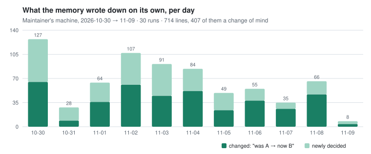
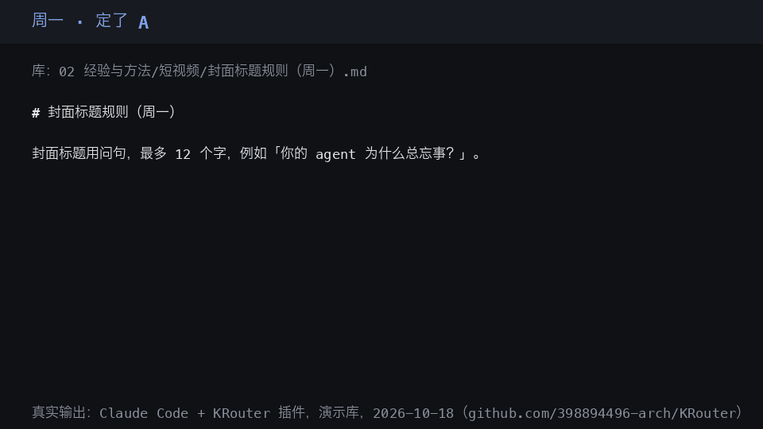

# KRouter in more detail

The parts of the [README](../README.md) moved here to keep its first screen short, word for word; nothing was dropped. 中文：[`OVERVIEW.zh.md`](OVERVIEW.zh.md)

## A writer's vault in Claude Desktop

**Not only for code.** The same in Claude Desktop, writing in the Obsidian vault you already keep (here a three-note
sample, [`docs/examples/writer-vault`](examples/writer-vault)). You are drafting a newsletter and say: *"Going to
open this week's newsletter with a question to the reader."* This is what the `krouter_ask` tool hands back (the
router's receipt on that vault, verbatim; its bookkeeping lines with the version, time and file paths are left out):

```text
recall_confidence: medium
recall_margin: 9.9
recall_strong_terms: 5
recall:
- Newsletter/Opening lines.md tier=other status=active score=3.148
  how: Do not open an issue with a question to the reader. Open with the one thing tha…
  L8 (passage L6-L8): Do not open an issue with a question to the reader. Open with the one thing that happened this week.
- Newsletter/Formatting.md tier=other status=active score=0.0
  how: Subject lines and headings in sentence case, no exclamation marks. One link per…
  L6: # Newsletter formatting
- Newsletter/Publishing schedule.md tier=other status=active score=0.0
  how: The newsletter goes out on Friday at 08:00. The draft is frozen on Thursday eve…
  L8 (passage L6-L8): The newsletter goes out on Friday at 08:00. The draft is frozen on Thursday evening; only typo fixes after that.
open_page: only the top recall hit, and only if its how does not close the question
```

KRouter hands over the rule, its page and how sure it is; what your agent says next is its own call. For your own
vault, add `--vault ~/MyVault` to the install below (Claude Desktop: its settings file while the app is closed, else a
double-click extension). Files already in the folder are kept, only missing ones added; each AI app's MCP settings are
written with a `*.krouter-bak` copy, plus the install's own folders under your home: [every file](INSTALL.md).

## Measured, not claimed

**Finding the whole answer, five pages per question.** A lookup now gives five pages: three that match the question,
then up to two the memory connects to them (a link, a replacement, the same session, rare words they share, being
cited together). On LongMemEval (ICLR 2025; 500 questions, each over about 50 chat sessions), scored from the
benchmark authors' own labels with no model, on the 235 questions held out while those connections were tuned on the
other half, **KRouter's five pages hold every session the answer needs for 210 questions; plain keyword search (BM25)
given five sessions, for 198** (12 more, paired 95% interval +3 to +21). On questions whose answer is spread over
several sessions: **40 of 47 against 31**. These are retrieval numbers: what the pages hold, not what a model answers
from them ([set 18](../bench/memory_honesty/HELDOUT.md#set-18-does-following-the-vaults-own-connections-bring-the-whole-answer-registered-2026-11-10-before-the-associative-path-was-written-or-any-held-out-question-was-run)).

**Answer accuracy for the five-page version** (KRouter 2.1.1's default pages, about 5.6 a question; [set 22](../bench/memory_honesty/HELDOUT.md#set-22-the-same-reader-five-pages-each--keyword-search-against-krouter-with-its-associative-path-registered-2026-11-10-before-any-reader-or-judge-call), Claude Sonnet 5.5 as reader and judge, 2026-11-13): **449 of 500 right (89.8%)**, held-out half 201 of 235 (85.5%). BM25 was not rerun at the same page count, so nothing is said about keyword search. The previous version, which gave three
pages (KRouter 1.3.0), got 400 of 500, level with BM25's three; that
table, with its version and page count, is in [`docs/NUMBERS.md`](NUMBERS.md#the-same-reader-three-pages-krouter-130).

**Finding the page** (earlier three-page versions), scored the same way. LongMemEval (KRouter 1.1.1): an answer
session is among the cited pages for 439 of 470 answerable questions (BM25: 447), and for 70 of 72 questions whose
fact changed later the newest one is cited. LoCoMo (ACL 2024; 1,986 questions over 10 long conversations): the first
page cited holds the evidence for 991 of 1,540 answerable questions (BM25: 968).

**Where it is weak:** a question about a near neighbour of something the memory does mention still gets an answer.
Its refusal gate turns down 9 of 30 LongMemEval questions that have no answer (set 14; the "3 of 30" quoted
before was 1.1.1), and 37 of 446 LoCoMo trick questions. On LoCoMo's
short conversations the two connected pages cost more than they bring: the five pages hold every evidence session for
1,185 of 1,536 questions, five pages of direct matches would for 1,204.

**On our own 200 held-out questions** (English and Chinese, never tuned on, written by Claude Opus in separate
sessions): KRouter cites a wrong page 26% of the time; claude-mem 64%, basic-memory 78%. Of 80 questions the memory
cannot answer, it refuses 47; the other two refuse none. Of 60 about a decision that was later changed, it gets 50
right; they get 34 and 16. Part of that gap is by construction: plain full-text search given KRouter's two rules
(leave replaced pages out, refuse a weak match) is level with it.

**So what KRouter adds** is a lookup that follows the memory's own connections (the lead above, at five pages; on
the first page cited it is level with plain search given the two rules), those two rules on by default, a receipt with
each answer (the page it came from, why that page, how sure), and a memory you can open and edit.
[Every number and its method](#honest-numbers) · [rerun them](../README.md#check-it-yourself) · [words used here](#words-used-here)

## Works with, in full

The README's table, with each app's test notes as they stood before it was shortened. Hermes and OpenClaw, added since: [`INSTALL.md`](INSTALL.md#hermes-and-openclaw).

One install wires every app it finds, writing each app's own MCP settings in the format that app documents. It keeps
the rest of the file and a copy of it, never touches a file it cannot parse or a `krouter` entry it did not write,
and `uninstall.sh` takes out only its own entries.

| App | How it connects | Status |
|---|---|---|
| Claude Code | plugin (session hooks) and MCP, both added by the installer | tested; in real sessions a Claude Sonnet 5.5 subagent given the same tool descriptions through a shell helper (not the MCP server) called `krouter_correct` on 3 of 4 decision changes and `krouter_learn` on 0 of 4 solved problems ([`VERIFY.md`](VERIFY.md#platforms-and-real-sessions-200-candidate-2026-11-10)) |
| Codex | MCP, and session hooks in `~/.codex/hooks.json` (trust them once with `/hooks`) | tested (command line, codex-cli 0.155.0-alpha.9.2, 2026-11-09): the MCP tools found, an answer with its page, a refusal; the hooks noted a typed correction and ran the turn-end and session-end imports. The CLI and the IDE extension share one configuration (Codex docs) Real sessions, 20 small tasks (2026-11-10, [`VERIFY.md`](VERIFY.md#platforms-and-real-sessions-200-candidate-2026-11-10)): it mentioned the digest's lesson when the situation matched (2 of 4) and never when it did not (0 of 12); it did not call `krouter_learn` or `krouter_correct` by itself (0 of 4 each), because this Codex version shows the model no krouter tool. The session hook now names both tools; that change could not be checked on Codex (its usage limit ran out) |
| Cursor | rule and skill, MCP (`~/.cursor/mcp.json`), and session hooks (`~/.cursor/hooks.json`) | rule and skill tested; the rest tested in the Cursor agent CLI 2026.11.05-86047df (2026-11-09): the MCP entry found, its tools listed, an answer with its page, a refusal; the turn-end and session-end hooks wrote the session pages. The CLI and the editor read the same MCP configuration (Cursor docs). A difference seen: the CLI's non-interactive mode did not run `beforeSubmitPrompt`, so a typed correction is not noted there Three real tasks in the agent CLI (free account, `auto`, 2026-11-10): it looked the tools up itself and called `krouter_correct` on a decision change; it did not call `krouter_learn` after fixing a Makefile |
| DeepSeek Harness | plugin (`dsh plugin --profile web add github:398894496-arch/KRouter`) | tested |
| Claude Desktop | an extension: double-click [`KRouter.mcpb`](https://github.com/398894496-arch/KRouter/releases/latest/download/KRouter.mcpb) and press Install once (no settings file, no restart; the app checks the extension online for a few seconds before anything shows). Or the installer writes its settings file, but only while the app is closed: Claude Desktop keeps its settings in memory and writes the whole file back when it quits, so an entry written while it is open is gone after a restart. Found running, the installer leaves the file alone and builds the extension for your memory folder instead | **extension tested inside the app** (Claude Desktop 4.23118.1, macOS, 2026-11-10): installed with one press, no restart; its 3 tools connected; in an ordinary chat a question was answered with its source page and an unknown one refused (`recall: none`). Tested with a build that names the full Python path, as the installer's does; the release file's plain `python3` takes another launch path in the app, not yet tested. The settings file is checked by tests |
| VS Code (Copilot) · GitHub Copilot CLI · Gemini CLI · Kiro · Zed · Cline CLI | MCP: the installer writes each app's settings file; restart the app once | settings checked by tests against each app's documented format; not yet tested inside the apps |
| LangGraph long-term memory (no MCP) | `krouter.integrations.langgraph.KRouterStore`, a `BaseStore`: per-user and per-thread namespaces as folders of Markdown pages, cited and refusing: [`docs/FRAMEWORKS.md`](FRAMEWORKS.md#langgraph-store-long-term-memory) | tested in real graphs (langgraph 1.0 and 1.2), in CI; not on PyPI yet |
| Agent frameworks: LlamaIndex, LangChain / LangGraph, OpenAI Agents SDK, Pydantic AI, Google ADK, CrewAI, Vercel AI SDK | a LlamaIndex retriever; the others through their own MCP client: [`docs/FRAMEWORKS.md`](FRAMEWORKS.md) | all tested against the server, in CI; three of them through their whole agent loop |
| Any other app that runs a local MCP server (Windsurf, opencode, Continue, Roo Code, …) | add the server below to the app's MCP settings | should work, not yet tested by us: [tell us](https://github.com/398894496-arch/KRouter/issues) |
| Your own code | a Python package and `krouter` command; a dependency-free JavaScript / TypeScript client (below) | tested |

```json
{ "mcpServers": { "krouter": { "command": "python3",
    "args": ["/Users/you/.agents/skills/krouter/scripts/mcp_server.py"] } } }
```

In the official MCP Registry as `io.github.398894496-arch/krouter` ([entry](https://registry.modelcontextprotocol.io/v0/servers?search=io.github.398894496-arch/krouter)), pointing at the release's
`KRouter.mcpb`, so apps that browse the registry can find it.

Use the full path to your home folder (on Windows, `C:\\Users\\you\\.agents\\…` and often `python`). The server is
standard-library Python over stdio with three tools: `krouter_ask` and `krouter_status` read; `krouter_note` lets
your AI write one line down (a decision, a correction, a fact). A note lands on that day's notes page as a clue,
never on a rule page, as one git commit you can revert.

## Five minutes later

1. Ask your AI: *"what did we decide about X last week?"* It answers from the memory, names the page, and says plainly when the memory has nothing on it.
2. Open the memory folder: each session since the install is there, one page each, with your questions and each turn's closing answer (the install's last lines give the one command that brings in the last 7 days too).
3. **"Have your model pull out what was decided?"** On a yes, the model you already use (a logged-in CLI or an API key) writes "what was decided, what changed" at the top of each recent session's page. The installer tells you how many characters that sends before it sends anything.

## It keeps up on its own

Nothing needs maintaining, and nothing waits for a yes except the two steps that send text to a model:
- **After every turn**, in Claude Code, Codex and Cursor, the session so far is written to its page when the agent
  finishes answering (locally, no model call, under a second), so another window's agent can already find it.
- **When you correct your AI**, a line that reads like a correction ("from now on…", "改成…") is written down the
  moment you send it. A new session starts with this repository's recorded decisions, corrections first, each with
  its page.
- **Every night** (the job asks first) yesterday's sessions are distilled and the memory is tidied; an optional timer
  also catches up during the day.
- **Nothing is hidden.** Every run writes what it added and replaced to the [change ledger](#words-used-here); in a
  git repository each run is one commit, and `import_sessions.py --undo <run>` takes it back.
- **Keep a session out** by putting `#nocapture` (or `#不记`) in any question of it.

**On the maintainer's own machine**, 2026-10-30 → 11-09, every number from its own change ledger
([method and tables](AUTO_CAPTURE.md#5-back-test-on-the-maintainers-machine-2026-10-30--11-09)):

<picture>
  <source media="(prefers-color-scheme: dark)" srcset="img/capture-days-dark.svg">
  
</picture>

30 runs wrote 714 lines, 407 of them a change of mind ("was A → now B"), each naming its session; none had to be
undone. Of 8 corrections the maintainer also wrote down by hand, 5 were in the memory by the next run: the distill
missed 2, and 1 was about the agent's own tool use, which import does not see. On the public decision-capture bench
(14 labelled decisions across 18 sessions, 4 of them with nothing decided; scored by rule) it found all 14 and wrote
no false line. A small set: it shows the distill does not invent decisions, not that it never misses one.

## Is it for you?

**Yes**, if you use an AI assistant, any one, and keep telling it the same decision again, or it keeps answering with
something you changed weeks ago. No notes yet? The installer makes the folder. Using several assistants is a bonus,
not a requirement: they then share one memory. **No**, if you want semantic search over embeddings, the last chat
replayed into the next one, a hosted memory service run for you (a self-hosted team server is fine:
[`docs/TEAM.md`](TEAM.md)), or a brain that is full on install.

**Not only for code:** the same story for short-video work, recorded the same way (Claude Code with the plugin, a
demo vault, real output):



**Not needed:** Obsidian (it is an optional viewer), an alias table to maintain, an environment variable to set.

## How it is different

| | KRouter | Typical agent memory |
|---|---|---|
| Where memory lives | Markdown pages you can open, edit, diff and sync | A database or vector store |
| After a correction | The new page replaces the old one, which is marked superseded | Old and new chunks both match; you hope the right one wins |
| When nothing matches | `recall: none` — your AI says the memory does not know | The nearest chunk, presented with confidence |
| Every answer | Carries its source page and a receipt | Usually unsourced |
| Who shares it | Every AI app on the machine reads the same folder (MCP, skill, rules) | Usually one tool |

**Coming from [claude-mem](https://github.com/thedotmack/claude-mem)?** Keep it. The installer finds its memory and
offers to import it (run end to end against claude-mem 13.35.0): session summaries become pages, each project's
decisions become one page, and your model can sort those into the ones still in force and the ones a later decision
replaced. Nothing is imported until you say yes ([details](DETAILS.md#importing-what-you-already-have)).

## Words used here

| Word | What it means here |
|---|---|
| memory, vault | The folder of Markdown pages ("vault" is Obsidian's word for it) |
| page | One Markdown file. A *rule page* states a standing decision and is answered from first; a day's *notes page* is only a clue |
| receipt | The lines that come with each answer: the page it came from, why that page, how sure |
| `recall: none` | The reply when nothing matches well enough; your AI is told to say it does not know |
| floor | The minimum match score, below which KRouter refuses instead of citing the nearest page |
| superseded | Replaced by a later correction: kept, marked, and left out of answers |
| distill | A model writes "what was decided, what changed" at the top of a session's page. It sends text out, so it asks first |
| change ledger | The page in the memory that lists what every run added and replaced. Default folder names are Chinese; a `krouter-zones.psv` at the vault root maps them to yours |
| bank | One memory on a team server, with its own address, index and token |
| session hook | A command an app runs when a session starts or a turn ends; this is how turns get recorded |
| MCP | Model Context Protocol, the standard way AI apps load outside tools |
| BM25 | The standard keyword-search ranking, used here as the plain baseline |
| held-out | Questions never used to tune anything |

## Honest numbers

Every number on this page, with its set, version, baseline and the result that did not go our way, is one table in
[`docs/NUMBERS.md`](NUMBERS.md); the sets were registered in
[`HELDOUT.md`](../bench/memory_honesty/HELDOUT.md) before their runs. What the sections above leave out:

| Measured | Result |
|---|---|
| Answer accuracy by question type, KRouter 1.3.0 at three pages ([set 11](../bench/memory_honesty/HELDOUT.md#set-11-longmemeval-answer-accuracy-scored-the-way-other-projects-report-it-registered-2026-11-09-before-any-run)) | single-session 61 / 64 (user) and 55 / 56 (assistant), knowledge update 69 / 72, temporal 97 / 127, preference 20 / 30, multi-session 69 / 121. A second judge agreed on 100 of 100 re-judged verdicts |
| Where the 93 questions lost to perfect retrieval went, three pages ([set 12](../bench/memory_honesty/HELDOUT.md#set-12-the-same-reader-given-different-things-registered-2026-11-09-before-any-run)) | KRouter had cited some but not all of the answer sessions for 58, none for 32, all for 3; 24 need more than three sessions |
| Off-topic questions (public benches, CI) | refused 12 / 12 (English) and 6 / 6 (Chinese) |
| Against a careful baseline ([200 held-out questions](BENCHMARK.md#third-bench-200-held-out-questions-on-a-vault-nobody-tunes-on-2026-10-13)) | plain search given the same two rules cites 42 wrong pages to KRouter's 36 and gets 96 right to 102; neither difference is significant |
| One lookup in its own process ([scale](BENCHMARK.md#scale-how-big-a-vault-can-get-2026-11-09)) | 0.13 s at 10,000 pages, 0.35 s at 50,000 |
| Exact match vs embeddings (CI) | exact match refuses where TF-IDF, MiniLM and BGE-M3 cite a neighbour; local embeddings are measured, not shipped ([`DENSE-OPTIN.md`](DENSE-OPTIN.md)) |
| The author's own 208 past questions, judged blind | KRouter 0.36, BM25 with the two rules 0.25 of 2, paired interval [−0.02, +0.24]: no difference shown |
